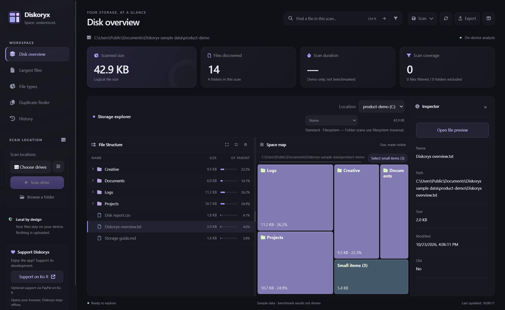
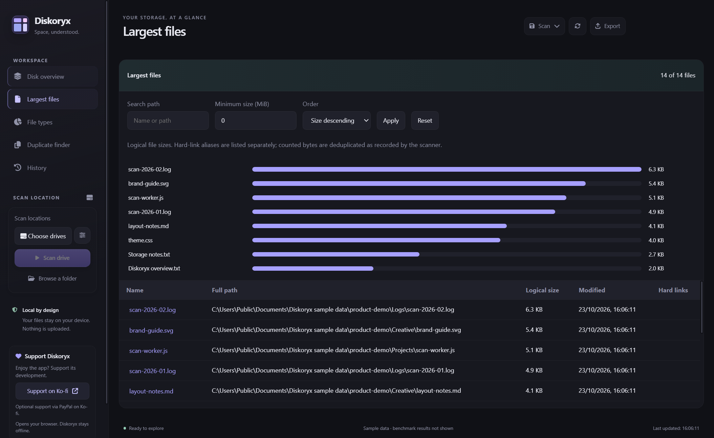
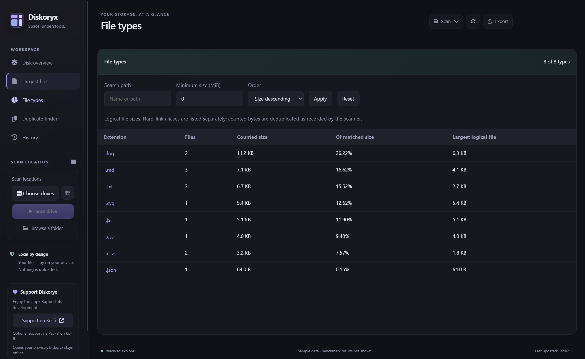
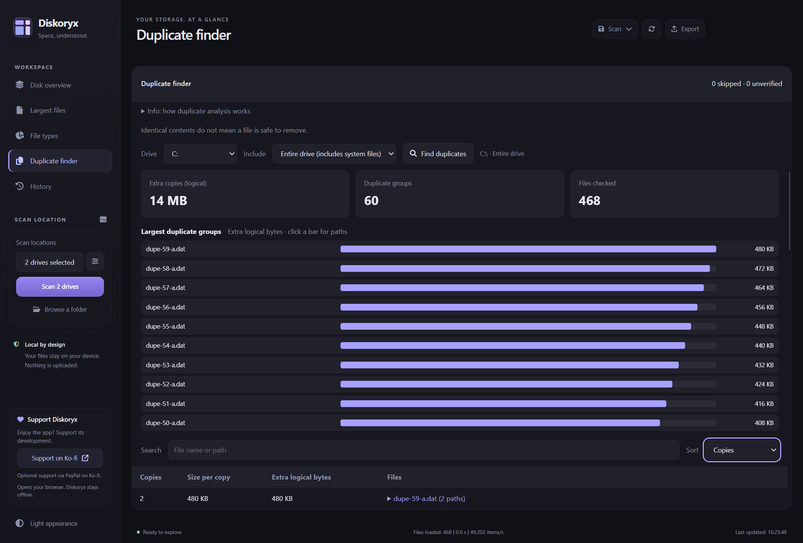
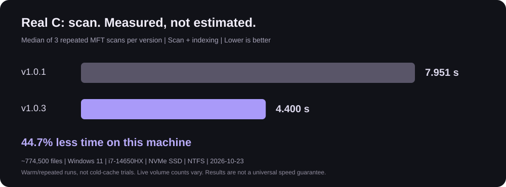

<p align="center">
  
</p>

<h1 align="center">Diskoryx</h1>
<p align="center"><strong>Space, understood.</strong><br>A fast, local-first disk space analyzer for Windows.</p>
<p align="center">Windows x64 &nbsp; | &nbsp; Offline analysis &nbsp; | &nbsp; Free &amp; open source</p>
<p align="center">
  <a href="https://github.com/ekadic7/Diskoryx/releases">Downloads</a> &nbsp; &middot; &nbsp;
  <a href="docs/technical-guide.md">Technical guide</a> &nbsp; &middot; &nbsp;
  <a href="https://github.com/ekadic7/Diskoryx/issues">Report a bug</a> &nbsp; &middot; &nbsp;
  <a href="https://ko-fi.com/F4K0297FJK">Support on Ko-fi</a>
</p>



Find what is taking up space, inspect large files, compare saved scans, and identify duplicate contents without uploading your filenames or files. Diskoryx combines an Electron desktop interface with a Rust NTFS MFT scanner.

## Explore your storage

| Feature | What you can do |
| --- | --- |
| **Drive and folder scans** | Choose one, several or all available drives; scan selected drives sequentially, or browse a folder. Stop a scan without starting the remaining queue. |
| **Storage explorer** | Browse a sortable file tree and linked space map, inspect file metadata, and switch between completed locations without rescanning. |
| **Largest files and file types** | Find large items with relative-size charts, path filters, sorting and paged results; drill into an extension's files. |
| **Duplicate Finder** | Analyze a selected drive, see the groups with the most extra logical bytes, and search, sort or expand their paths. Equality requires full-file SHA-256 checks, not matching names or sizes alone. |
| **Saved scans and Compare** | Save metadata to a local `.diskoryxscan` file, reopen it read-only, and compare a baseline against a fresh scan of its original location. |
| **Advanced search** | Search the cached scan with filename patterns, size/date conditions and Boolean expressions, or use the filter dialog. |
| **Text preview** | Read text, configuration files, source code and large logs in bounded pages, with page jumps and line wrapping. Files are never executed. |
| **Guarded file actions** | Rename, recycle, create folders, copy and move through in-app dialogs, with supported Undo/Redo and action history. Occupied destinations are refused rather than overwritten. |
| **CSV and CLI** | Export the selected scan in the interface, or run read-only folder-to-CSV automation from source. |
| **Your workspace** | Dark and light appearances, an optional Inspector, and a free-space card separate from scanned logical sizes. |

<p align="center">
  
  
</p>

Screenshots show generated sample files and sanitized display paths, not private data. Gallery images are demonstrations, not performance measurements. [View the light appearance](docs/screenshots/overview-light.png).

## Duplicate contents, not cleanup guesses

Duplicate Finder defaults to **User files**, leaving out Windows, installed-application and user AppData directories. Select **Entire drive** explicitly to include those locations.

A completed full-drive inventory can be reused to avoid another directory scan. Unique sizes are removed first; large candidates pass bounded sample checks before full hashing. Metadata validation is concurrent, while identity and changed-file checks remain in place. Reused inventories describe the last scan: **Rescan** to include newer files and size changes.

Results are informational: differently named files can contain the same bytes, and an application may need every copy. There is no automatic duplicate deletion. Extra logical bytes are not a promise of recoverable physical disk space. Content analysis takes additional time even after a fast MFT scan and may download online-only cloud files through their storage provider.



## Real-drive scan benchmark

On the same C: NTFS volume, three repeated MFT scans measured a median of **7.951 s in v1.0.1** and **4.400 s in the v1.0.3 candidate**: **44.7% less scan/indexing time** on this machine, across approximately 774,500 files.



These are warm/repeated runs on a live Windows volume, not cold-cache trials or a speed guarantee. Scanner timings exclude UAC waiting; the volume changed slightly between runs. [See the real screenshots with private names blurred, hardware, method and raw results](docs/benchmarks/v1.0.3/README.md).

## Get started

Use a Windows x64 build from [Releases](https://github.com/ekadic7/Diskoryx/releases). A locally prepared candidate is not published until its release is approved.

| Build | Use |
| --- | --- |
| `Diskoryx-Setup-1.0.3.exe` | Per-user installation with Start menu and desktop shortcuts. |
| `Diskoryx-Portable-1.0.3.exe` | Launch without installation. Extracts its runtime temporarily; settings and history still use `%APPDATA%\Diskoryx V1`, not the executable's folder. |

Launch normally, **not as administrator**. The separate NTFS scan worker may request UAC; the interface and file actions keep your normal permissions. Folder scans use filesystem traversal without UAC. No Node.js is needed for either desktop build.

**This is an unsigned, early testing release.** Windows SmartScreen may show a warning. Keep backups and try file actions on disposable files first. Diskoryx reports **logical file sizes**, not allocated "Size on disk"; it is not a backup or automatic cleanup tool.

## Privacy and offline operation

The interface, icons, fonts, charts and scanners are bundled locally. Disk analysis has no account requirement, CDN dependency or automatic upload. The optional Ko-fi button opens your browser only when clicked.

Saved scans and CSV exports contain filenames, paths and metadata. They are local, unencrypted files: share them only after checking for private information. File previews stay on the device.

## Command-line folder export

The CLI currently runs **from the source checkout with Node.js 22 or later**. It is not an installed `diskoryx` command and does not use the fast MFT drive scanner.

```powershell
# Show arguments and exit codes.
node .\src\main\cli.js --help

# Read a folder and create a new CSV; existing output is refused.
node .\src\main\cli.js scan "C:\Data" --csv "C:\Reports\diskoryx.csv"

# Replace an output file only when explicitly requested.
node .\src\main\cli.js scan "C:\Data" --csv "C:\Reports\diskoryx.csv" --force
```

Create the output directory first. The command scans files read-only; only the requested CSV is written. Standard output contains a JSON summary, diagnostics go to standard error, and Ctrl+C cancels. Exit codes: `0` success, `2` arguments, `3` scan failure, `4` output already exists, `5` write failure, `130` cancellation.

Without `--force`, complete-output publication requires filesystem hard-link support, such as NTFS. Unsupported output filesystems fail explicitly rather than falling back to an operation that might overwrite another file.

Search examples in the interface:

```text
*.pdf size:>10MB
*.jpg OR *.png
report NOT old
modified:>=2025-01-01 size:<=500MB
```

Spaces imply AND; Boolean operators are uppercase. Date boundaries are UTC and size units are powers of 1024. Expressions do not support quoted phrases or parentheses.

## Run and build from source

Use Windows x64, Node.js 22 or later and a normal PowerShell. Restoring dependencies needs access to the npm packages or an existing local cache; running the installed app does not.

```powershell
npm ci
npm run build:scan-broker
npm test
npm start

# Build both local Windows release artifacts.
npm run build:release:win
```

Native-helper builds use the local .NET Framework x64 C# compiler. Packaging verifies the bundled MFT scanner against its pinned SHA-256. Build instructions, scanner accounting, archive limits and file-action safeguards are documented in the [technical guide](docs/technical-guide.md). Contributions are welcome; see [CONTRIBUTING.md](CONTRIBUTING.md).

The [v1.0.3 verification record](docs/release-verification-1.0.3.md) lists the actual interface coverage and remaining manual acceptance checks; automated tests are not a claim of exhaustive Windows certification.

## Feedback

[Report a bug](https://github.com/ekadic7/Diskoryx/issues) with your Diskoryx and Windows versions, the steps you took, and what happened. Hide private filenames, full paths and file contents in screenshots.

## Support development

[](https://ko-fi.com/F4K0297FJK)

Diskoryx is free. If it helps you, [support its development on Ko-fi](https://ko-fi.com/F4K0297FJK), including optional support via PayPal. No features are locked behind a payment.

## License

[MIT](LICENSE).
