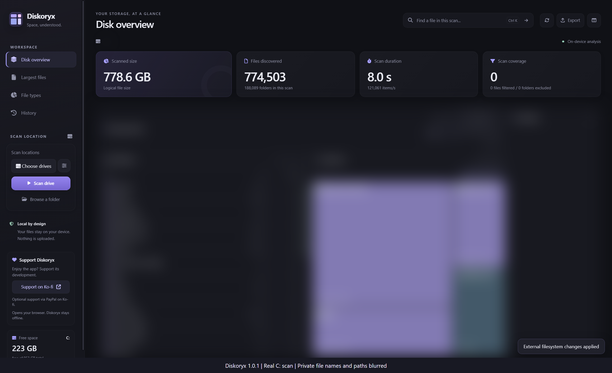
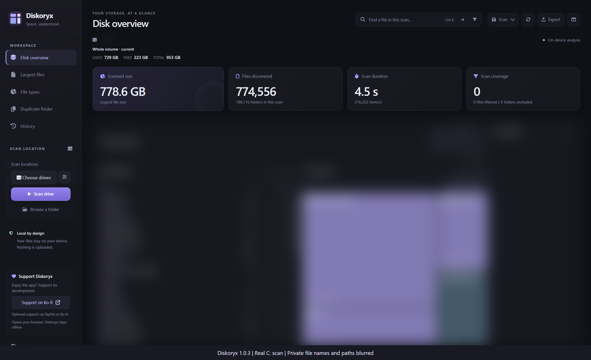

# Scan benchmark: v1.0.1 vs v1.0.3

Measured locally on 2026-10-23 using the actual C: NTFS volume. No file contents were hashed for this benchmark. The published evidence contains only aggregate scan metadata; filenames and paths are blurred in the screenshots before image capture.

## Results

Three sequential scans per version, with no excluded folders or file filters. Lower times are better.

| Measurement | v1.0.1 | v1.0.3 candidate |
| --- | ---: | ---: |
| Scan 1 | 7.616 s | 4.400 s |
| Scan 2 | 8.031 s | 3.883 s |
| Scan 3 | 7.951 s | 4.452 s |
| **Median scan + indexing** | **7.951 s** | **4.400 s** |
| Median request-to-rendered-tree | 8.043 s | 4.473 s |
| Files at scan completion | 774,503 | 774,552-774,555 |
| Folders at scan completion | 188,089 | 188,116 |
| Skipped entries | 0 | 0 |
| Scanner mode | MFT | MFT |

The median scan/indexing time was **44.7% lower**, or **1.81x the throughput**, on this machine. This is a local repeated-run observation, not a promise for other disks or computers.

  
  

Screenshots show the final run of each version, not the median. Background notifications can update visible counts after a scan completes. No displayed times or counts were replaced.

## Environment and method

- Windows 11 Pro, build 26300; Intel Core i7-14650HX, 16 cores / 24 logical processors.
- C: NTFS, 1,023,041,073,152-byte volume on an SKHynix HFS001TEJ9X115N NVMe SSD.
- Electron 44.7.2 for both versions, using their own main/preload/renderer code and native scanner/broker images.
- v1.0.1 was extracted without installation from the retained local `Diskoryx-Setup-1.0.1.exe`, SHA-256 `BE7D1C6C8090B2A416A93CDBF8895174825E9587E7EC9AC7090B3ECF66AA1425`. Its bundled package reports version 1.0.1.
- v1.0.3 used the reviewed Buffer candidate. Its scanner SHA-256 is `BB1A991D3A4602558128BB5B709AEA4E4099D360181BCB73A4C7A8DE212522F7`.
- The harness clicked **Browse a folder** with C: supplied by the native-dialog test seam, then **Rescan** twice. There were no scanner, broker, scan-result or filesystem mocks. All six runs required and reported MFT mode. The user approved the real UAC prompts.
- Each version used an isolated profile and a hidden real Electron window. The harness observed `diskoryx:scan-start` / `diskoryx:result` events; result events outside an active scan were ignored. Render readiness additionally required enabled controls and a rendered tree row, polled every 25 ms.
- Scan duration is the application's scanner/import/indexing metric and excludes UAC waiting. Request-to-tree time includes UI work and any UAC wait; its first run is therefore not a pure scanner timing.
- The old version's three scans ran before the new version's three scans, with a one-second pause between runs. OS caches were **not** flushed, and preliminary runs had already warmed the volume. These are not cold-cache measurements or randomized trials.
- The live Windows volume continued changing: file counts and logical byte totals are not expected to be identical. These measurements do **not** establish old/new output parity. Source scanner regressions and synthetic parity fixtures provide separate correctness evidence.
- No comparison against Explorer or another vendor is inferred from these results. This is not a Duplicate Finder benchmark.

## Raw evidence

- [v1.0.1 run records](baseline-1.0.1.json)
- [v1.0.3 run records](candidate-1.0.3.json)

The JSON records preserve unrounded timings, counts, timestamps, runtime versions, renderer errors and HTTP request counts. Both runs recorded zero renderer errors and zero HTTP requests. The rounded table above is derived from those records.
